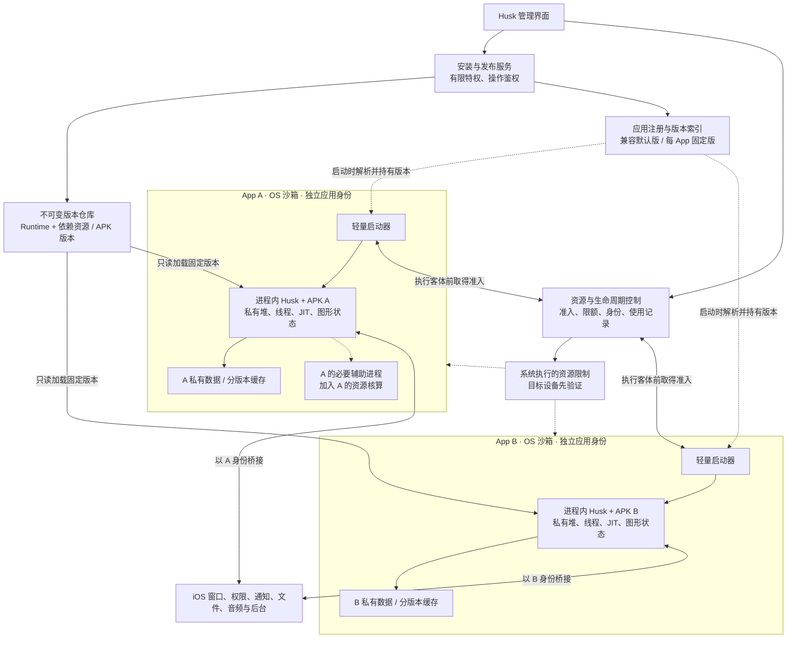
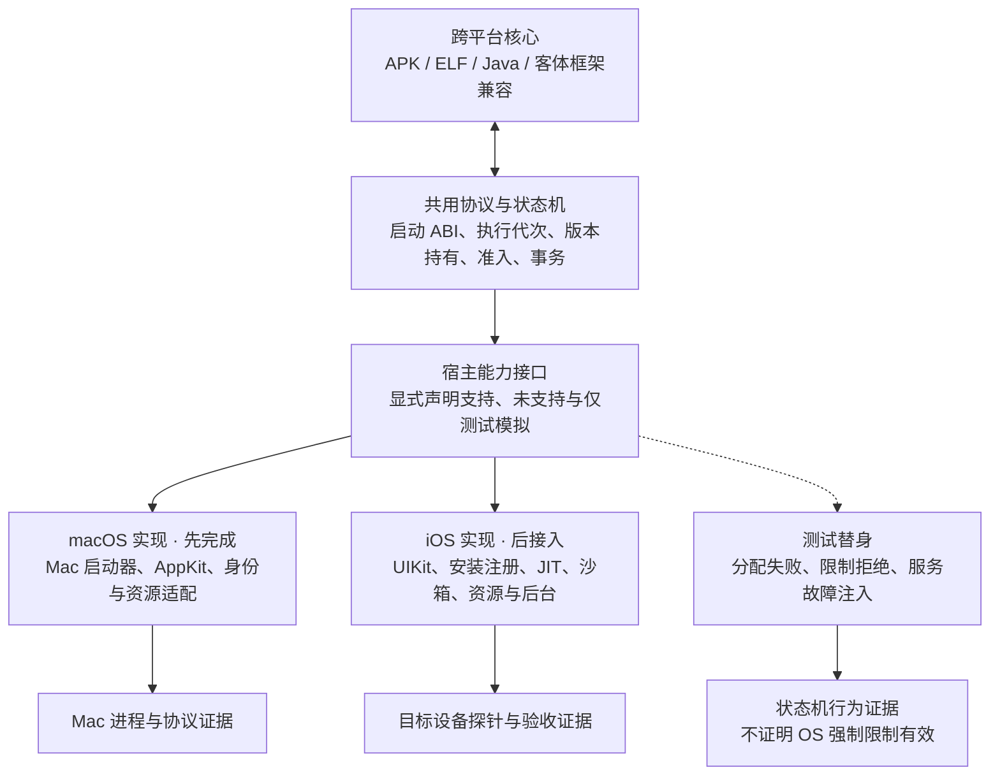
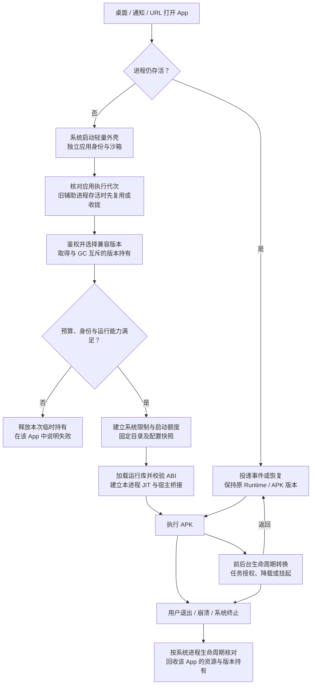
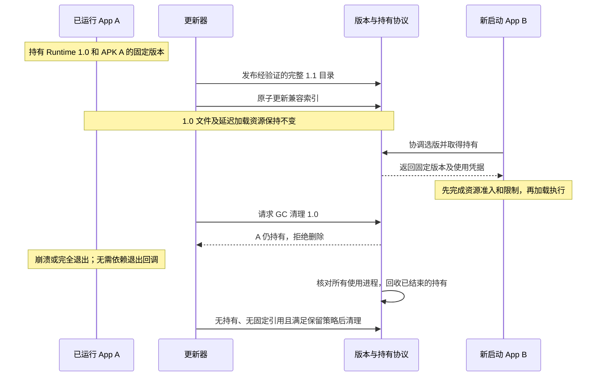

# Husk 独立应用运行环境：架构与设计

状态：**目标设计，M1 的 macOS headless-bootstrap 初版已实现并本地验证；独立 App 外壳、完整 APK 启动接口与 iOS 接入尚未完成。Mac 测试不构成 iOS 能力或隔离效果的验收。**

日期：2026-11-06。源码核对基线：`fcda33e2ee6c63ad2742199016d49bcad2730672`。

配套：[执行方案与验收计划](08-independent-app-runtime-execution-plan.md)。
当前实现：[macOS M1 入口、验证与限制](09-macos-runtime-m1.md)。
本文约束后续实现；[早期 QEMU 架构](00-architecture.md)及已有单宿主运行方式继续作为历史和现状资料。

## 1. 产品目标与保证范围

用户导入 APK 后得到一个可从桌面直接启动的独立 iOS App。它拥有稳定的应用身份、窗口、任务卡片和私有数据，通知、权限、分享和后台任务逐步接入 iOS。Husk 管理器承担安装、更新和设置，日常启动不需要进入管理器界面。

每个 App 的轻量启动器在**创建新进程时**选择兼容运行库并加载。已经存活的进程，包括从后台恢复的进程，保持原运行库和 APK 版本。运行库集中分发，各 App 的运行状态在各自进程内。

| 目标 | 契约与边界 |
|---|---|
| 普通崩溃隔离 | A 的段错误、未捕获异常、主动退出和运行时局部错误，不应导致 Husk 主动结束 B；通过双 App 故障注入验收 |
| 内存独立 | 私有地址空间、堆、线程、JIT 可写区域及按 App 核算的资源预算；共享只读代码不改变这一边界 |
| 超额控制 | 在已验证的设备、系统和并发预算内，优先拒绝 A 的超额任务，必要时由系统限制结束 A；不能靠低频轮询兑现此目标 |
| 整机压力 | 各 App 的上限不是物理内存预留；不能保证任何整机压力下 B 永不被 jetsam、系统或驱动故障影响 |
| 原生使用体验 | 入口、系统身份和生命周期接入 iOS；APK 自身页面仍可保留 Android 风格，兼容性逐 APK 验证 |
| 动态升级 | 兼容运行库更新通常无需更新外壳；启动接口、签名权限、Info.plist 或扩展变化仍可能需要更新 `.app` |

第一阶段针对翻译层已经兼容的 APK，先验证两个 App。不能把“生成安装外壳”解释为“所有 APK 都能完整运行”。QEMU、PS4 和共享 Android 虚拟机不纳入首期：同一 QEMU 宿主承载多个 APK 会重新引入共同故障边界。

## 2. 必须保持的设计约束

| 编号 | 约束 |
|---|---|
| INV-01 | 一个 App 身份对应自己的主进程及可追踪的辅助进程集合；由系统应用启动路径建立，核验资源归属，不只检查 PID 不同 |
| INV-02 | APK 进程保持低权限和独立 OS 沙箱；不得为加载公共库而给全部 APK root、跨 App 写权限或通用调试权限 |
| INV-03 | APK 主循环、Java 堆、JIT 可写区和图形执行留在所属 App 中；控制服务不执行 APK 业务代码 |
| INV-04 | 客体执行和重型 JIT 初始化前，必须完成资源准入并确认系统限制有效；运行库构造函数也不得绕过该顺序 |
| INV-05 | 保留现有统一手动 JIT 值与 Java 工作线程 32 MiB 原生栈；预算不足时解释并拒绝新任务，不自动估算、学习、扩容或缩小这些设置 |
| INV-06 | Runtime 与 APK 都按完整不可变版本发布；同一应用执行代次的主/辅助进程固定 Runtime、APK、配置与数据格式代次，禁止经可变 `current` 路径延迟读取依赖 |
| INV-07 | 选版本、取得版本持有权和垃圾清理互斥；崩溃、强杀和后台挂起均不能造成错误释放 |
| INV-08 | 管理服务失联时保留已有系统限制及版本持有，冻结新准入、预算扩张和不确定的清理，不统一杀死现有 App |
| INV-09 | 用户数据独立于 Runtime/APK 版本；可重建缓存按版本隔离，数据迁移与代码回滚单独设计 |
| INV-10 | 所有管理 IPC 按真实调用者身份授权，具有逐 App 队列、大小、频率和超时限制，不信任传入包名或 PID |
| INV-11 | 用户完全关闭 App 后默认不自动复活；崩溃恢复有退避，不能产生自动重启和内存分配风暴 |
| INV-12 | 未经目标设备验证的沙箱、JIT、后台和内存控制能力标记为未知；源码编译和模拟测试不替代设备验收 |

## 3. 整体架构



图中的模块是职责划分，不要求每个模块单独成为守护进程。特权安装操作与不可信 APK 解析隔离：解析器不以 root 执行 APK 代码；路径穿越、解压大小及符号链接必须受约束。

每个 App 的系统身份包括稳定 Bundle ID、实际签名/权限、沙箱容器、进程实例和必要辅助进程。Android 包名及签名者属于客体身份，须与 iOS 身份明确映射。主进程、WebKit 等辅助进程和系统服务的资源归属需要实测；不能把所有宿主子进程都算入 Husk 管理器，也不能未经验证就认为不同 PID 属于不同资源组。终止操作只针对已确认属于该 App 的执行进程；共享系统服务通过取消该 App 的会话释放资源，不能因 A 超额而结束 B 也依赖的服务。

### 3.1 macOS 验证宿主与平台分层

先在 Apple Silicon macOS 上实现并验证公共 Runtime、独立进程外壳、版本仓库、租约、执行代次和资源调度协议；目标 iOS 27 环境可用后，再接入平台实现并重复关键验收。macOS 是真实运行同一批核心源码的开发宿主，不是对 iPhone 内核、安全策略和后台机制的等价仿真。



| 边界 | 可共用部分 | 平台实现与重新验证 |
|---|---|---|
| Runtime | APK/DEX/ELF、JNI/Bionic、框架语义和资源路径契约 | 系统调用、可执行内存、字体/图形及宿主框架依赖按目标编译和适配 |
| 外壳与身份 | 启动 ABI、包身份、生命周期事件协议 | macOS 应用入口/AppKit 与 iOS UIKit/Scene、注册及容器不同 |
| 版本与持有 | 清单、不可变目录、索引事务、GC 协议、执行代次 | 锁/IPC/文件访问的实际权限及崩溃行为须分别验证 |
| 资源调度 | 总预算、并发准入、峰值归还与失败释放状态机 | footprint 计费、硬限制、辅助进程归属和服务重启后的限额持续性不照搬 |
| 系统集成 | 抽象的通知、权限、文件、音频及任务事件 | 桌面窗口、移动后台/锁屏、推送和数据保护按平台实现 |

宿主接口至少划分 `ProcessHost`、`IdentityAndStorageHost`、`ExecutableMemoryHost`、`ResourceController`、`LifecycleHost` 和 `SystemUIHost`。这些名称是拟定职责，不是当前已存在的 API。策略核心不能通过“当前是 Mac”就把未知能力默认标记为成功。

资源控制必须分别返回观测能力与强制执行能力。可使用 `unsupported`、`observed`、`simulated`、`enforced-and-verified` 等状态；预算状态机的测试替身只能标记为 `simulated`。macOS 若没有已验证的硬限制，仍可做受控、有限工作集的功能原型和故障注入，但不满足目标保护模式的 INV-04，也不能进行无边界的 OOM 压力试验或宣称已完成强内存隔离。

Mac 命令行程序用不同数据目录运行，只能证明进程和路径逻辑；同一用户下未启用 OS 沙箱的两个程序，不能因此宣称数据、信号或 task port 已隔离。Mac 外壳应另行验证 App Sandbox、签名和公共库加载边界，iOS 再按自身规则验证。

Runtime 按宿主平台、架构与完整内容标识分别构建，例如逻辑布局为 `RuntimeStore/<platform>/<arch>/<build-id>/`。macOS arm64、iOS device arm64 和 iOS Simulator 不是可互换的二进制目标；迁移复用源码、协议和测试用例，不直接复制 Mac 的 dylib、系统资源配置或签名到 iPhone。派生缓存也包含宿主平台与转换工具版本。

iOS Simulator 可作为 UIKit 外壳与部分事件桥接的补充测试，按投入收益选择；不能代替真机验证 JIT/TXM、安装权限、Jetsam、锁屏后台或设备 GPU 行为。iOS 探针 P0 是设备阶段的门槛，不阻塞 Mac 上的核心实现。具体先后与证据分类见[执行方案](08-independent-app-runtime-execution-plan.md)。

## 4. 组件与接口边界

### 4.1 轻量启动器与进程内 Runtime

启动器负责 UIKit/Scene 入口、稳定系统身份、版本解析、资源准入、加载和错误呈现。通知点击、URL 和生命周期事件进入对应 App，再转交它的 Runtime。独立进程中的已有全局变量可以继续使用，不要求为了多 App 并行而先实现同进程多实例。

拟定一个带 `struct_size`、主/次 ABI 版本与能力协商的窄 C 接口；具体符号在实现阶段确定，以下字段是契约而非现成 API：

| 上下文 | 含义 |
|---|---|
| App / process identity | 已认证的安装身份、应用执行代次、客体包身份、进程角色和进程实例标识；PID 只是其中一个字段 |
| host target / capabilities | 宿主平台、架构、构建目标与已验证能力；测试模拟能力与真实系统执行能力明确区分 |
| `runtimeRoot` | 完整不可变 Runtime 版本的固定目录及内容摘要 |
| `packageRoot` | 固定 APK 版本目录，包含完整 base/split 集与该版本 native libraries |
| `dataRoot` / `cacheRoot` / `configRoot` | App 私有持久数据、按 Runtime/APK/ABI 分版本的可清理缓存和私有配置；配置在启动时形成快照 |
| configuration snapshot | 此次启动使用的手动 JIT 值、图形配置及资源策略版本 |
| resource grant | 已验证的主/辅助进程预算和使用凭据，不是客户端自行声明的权限 |
| host callbacks | 窗口、输入、文件授权、权限、通知、音频和生命周期回调 |

ABI 不直接暴露跨版本 Swift 类型布局；内存由哪一侧分配/释放、回调在哪个线程、异步取消和进程退出语义需写入接口规范。ABI 不兼容时选择已验证旧版或提示更新外壳，不继续强行启动。

运行资源不得再默认从 `Bundle.main` 寻找。`dlopen` 会执行初始化代码，因此构造函数只允许受预算覆盖的轻量初始化；客体代码执行、JIT 大块申请和重型图形初始化放在显式启动阶段。每个进程独立完成有效 JIT 路径；不共享可写 JIT 内存，也不把管理器已有权限当成 App 的权限。

### 4.2 管理与特权服务

只处理安装注册、版本发布、准入、资源限制及必要后台授权。认证必须使用可验证的 OS 调用身份，并验证目标是否属于请求者；客体包名、PID 和文件路径均为不可信输入。

每 App 使用独立请求配额和有界队列；长任务不能占用唯一全局执行线程。日志、磁盘写入、连接、线程和文件句柄也需要边界，避免 A 通过共享资源耗尽间接影响 B。

服务故障时，已加载 App 的 Java、渲染和本地文件操作继续独立执行；依赖服务的操作返回可恢复错误。后台断言可能受服务死亡影响，必须专项验证，不能从“业务进程独立”推导后台永远存活。

## 5. 隔离与资源契约

### 5.1 地址空间、数据及系统权限

每 App 可写数据默认私有；公共库和其他 App 目录不能写。Android `/sdcard` 默认映射到本 App 的外部存储模拟目录，跨 App 共享通过受控文件授权实现。共享目录名称本身不构成沙箱。

客体 PID/UID、信号、进程创建和跨 App Binder/Provider 请求通过受控映射；拒绝未授权目标。宿主 OS 沙箱是最终边界，Bionic 函数过滤只是兼容与防御措施。允许应用访问公共运行库所需的最小读/执行权限，必须在目标越狱环境下验证；无法兼顾时，停止该共享库方案的隔离验收，不以取消全部沙箱作为替代。

### 5.2 内存准入与限制

资源控制包含三层：Runtime 内提前拒绝可控的大分配、系统级进程限制、所有已准入 Husk App 的总预算。前两者应让超额 App 局部失败；总预算降低触发整机 jetsam 的概率。

对 App i 记录预算 B_i、可观测的主/辅助进程占用 F_i 和启动峰值额度 S_i。仅在既有预算承诺、并发启动额外额度与新请求合计不超过策略总额度 H 时准入。S_i 只计算超出稳态预算的临时部分，避免重复记账。该条件是保守的调度规则，**不是预留物理页，也不是绝对存活证明**。

- H 必须为系统、原生 App、服务和瞬时峰值留余量；不能把每个进程的 `os_proc_available_memory()` 相加得到 H。
- 核算以可验证的 footprint 和系统归属为基础，覆盖 native、JIT、线程、图形/IOSurface 与辅助进程；不能只统计 Java 堆、虚拟地址预留或简单累加共享页 RSS。
- 辅助进程创建前需要纳入额度。只能控制逐进程上限时，应划分有约束的份额，不能假装存在天然的每 APK 聚合硬上限。
- WebKit、图形或系统服务中不能可靠归属/限制的资源必须记录为缺口，以并发限制和实测余量约束；未闭合前不能宣称完整资源隔离。
- 系统硬限制需在前台、后台、锁屏、恢复后验证。soft high-water mark、压力通知、轮询监控均不能替代这一能力。
- 预算不足时拒绝新的启动、辅助进程或重任务，保留手动 JIT 配置和 32 MiB 工作线程栈；不自动降低配置来伪造准入成功。
- 业务正常退出、崩溃或超额终止后，只回收所属 App 的凭据和资源；禁止对全部 Husk App 执行统一 teardown。

启动峰值额度 S_i 不能在“首帧出现”或“初始化回调完成”时直接退回。先释放临时资源，确认所属进程实际占用收敛到稳态预算，再使所有有效系统限额收敛到稳态份额并核验，最后在准入账本中协调退回 S_i。未完成收敛时保留额度或结束本次启动，不能将同一份峰值额度再次授予其他 App。

失败释放也必须有屏障：停止本次工作，等待线程、异步消费者及所属辅助进程结束，并确认资源释放后再归还预算。无法证明进程内清理完成时，结束该 App 的相关进程并等待系统确认；外壳错误界面若继续存活，其基线开销仍要核算。版本持有在最后一个使用者结束后才能释放。状态不确定时保留记录与回收余量，不能通过先清账再清理放行下一次启动。

同一设备的 RAM、CPU、GPU、内核和服务仍共用。A 在预算内也可能与 B 竞争资源，外部原生 App 也可能引发压力。最终承诺只能覆盖已测试配置和并发范围；不能保证任意负载下 B 永不被系统终止。

### 5.3 控制服务失联

服务死亡或账本状态不确定时：保留内核中已生效的限制，已有进程保留自己的版本持有；冻结新准入、预算扩张和旧版本清理。禁止因心跳消失或 TTL 到期释放存活进程的额度，后台挂起并不等于退出。

恢复时按进程实例身份核对存活进程、真实限额和持有记录，完成账本重建后恢复准入。不确定时保守保留额度与文件，不能通过清零账本或杀掉所有 App 恢复一致性。限额若依赖控制服务持续存活，必须把这个缺口列为能力探针失败。

## 6. 安装、启动与生命周期

安装器验证包结构、目标 ABI、包名和签名者，保存不可变 APK 版本，并生成稳定身份的 `.app`。同包名更新必须验证签名连续性或受支持的签名轮换；不匹配时作为不同安装身份或拒绝覆盖，不能授予原应用数据。

包索引、外壳部署与系统注册无法假定是同一个 OS 原子操作。使用有日志的安装事务、可恢复状态和补偿步骤，只有组件及注册一致后才标记可启动；中断时保留上一个完整安装。



启动失败进入统一回滚路径，经过第 5.2 节的释放屏障再回收本次准入与持有；进程强杀则由系统生命周期兜底。入口及初始界面必须遵守系统启动时限，不能在主线程无限等待服务或 JIT 授权。

后台任务分为系统可支持的音频/下载等任务、需要越狱适配的持续执行，以及可挂起的普通界面。挂起保留进程状态和版本持有。后台时及时降低 UI/图形负载，但不能盲目暂停承担业务的事件循环。锁屏还要验证数据保护与资源可读性，不自动降低全局数据保护等级。

用户完全关闭后的默认状态为停止：记录带执行代次的停止状态，取消所属 App 的待重启请求，并收拢其辅助进程，拒绝旧代次延迟抵达的请求，不能被 `START_STICKY` 等客体逻辑立即拉起。无法可靠识别用户强退时不启用自动复活，保留用户显式打开的入口。系统重启、重新进入越狱环境和崩溃恢复遵守明确的启动策略。自动恢复仅在用户启用的具体任务范围内进行，有退避与熔断。

## 7. 不可变版本、发布与垃圾清理

下列为逻辑布局，实际路径由 rootless 平台定位和容器 API 决定，不硬编码 `/var/jb` 或其他容器 UUID：

```text
RuntimeStore/<platform>/<arch>/<build-id>/  完整运行库、依赖、Java 包、字体、证书、清单
PackageStore/<install-id>/<revision>/  base/split APK、库、资源、签名身份清单
Registry/                             安装事务、兼容索引、策略；仅管理服务写
LeaseRegistry/                        稳定锁身份与进程使用记录；协议保护
AppContainer/<install-id>/Data/        私有持久数据
AppContainer/<install-id>/Cache/<platform>/<runtime-id>/<apk-revision>/<abi>/
```

App 只获得选定版本所需的最小只读访问权；APK 私有内容也不能因放在仓库就对其他 App 全部可见。版本标识须绑定完整内容摘要，不能用可覆盖的普通版本号作为唯一身份。

发布流程：暂存完整版本 → 验证清单、完整性、签名/加载条件、ABI 和必要迁移 → 发布不可变目录 → 原子更新兼容索引。索引与目录的提交需具备掉电恢复能力。未完成版本不得进入候选集。

兼容索引记录默认版本和每 App 固定版本；一个 App 出现回归时只调整该 App 的选择。先做小范围验证，再推广默认版本。修复运行库缺陷与修改外壳是两种发布，不能承诺外壳永远无需升级。

### 7.1 版本持有协议

1. 选择 Runtime/APK 版本与取得使用凭据，必须与发布索引和 GC 的删除决策协调；禁止存在“选中但尚未保护”的空窗。
2. 采用经过设备验证的跨进程锁/持有协议。普通打开文件或目录句柄不能阻止 `unlink`；GC 必须遵守同一共享/排他协议，锁对象本身不能被替换。
3. 持有由实际使用版本的进程承担，必要辅助进程分别持有；主进程退出不能释放仍被辅助进程使用的版本。锁/句柄移交与启动失败需可回滚。
4. 持有绑定可验证的进程实例，不能只保存可复用 PID。正常退出上报只作优化；崩溃、强杀、服务重启必须仍能恢复正确状态。
5. 挂起、长时间无心跳或管理服务失联不能判定为无人使用。GC 在状态不确定时停止删除。
6. 只有无活跃持有、不是任何 App/默认索引所需版本、且不在回退保留范围内，才可清理完整版本。空间不足时拒绝更新，不能删除在用版本腾空间。

### 7.2 APK 更新、卸载与数据回滚

APK 更新与 Runtime 更新采用同样的版本持有语义。普通内容更新可使旧进程继续旧版本、下次新进程切换；涉及 `.app` 签名、权限或系统注册变化时采用受控停机更新，不能假定系统安装器允许无中断替换正在使用的外壳。

同一安装身份的主/辅助进程绑定同一应用执行代次，固定 Runtime、APK、配置快照及数据格式代次。同一数据目录不能由两个不兼容执行代次并发写入，这同样适用于仅升级 Runtime、APK 未变的情况。主进程退出但辅助进程仍存活时，新主进程只能经验证地恢复原代次，或等待旧代次全部结束后创建新代次；首期采用收拢旧代次再启动的简单策略。不能独立选最新版而与旧辅助进程混用数据。

更新切换需等待所属旧进程集合结束，并在需要时完成明确的数据迁移。持久数据迁移先取得该安装的独占数据写入权，迁移成功不替代停止旧写入者。卸载先禁止新启动、停止所属主/辅助进程并确认退出，再按用户选择清理数据和版本引用。

可重建缓存按版本隔离。持久格式迁移必须有兼容范围、失败恢复和必要备份，不能用“切回默认指针”冒充数据回滚。APK 回退还需遵循应用自身的数据格式与签名规则。



## 8. 原生体验与 Android 语义

| 能力 | 设计要求 |
|---|---|
| 桌面与窗口 | 每 App 独立 Bundle ID、图标、Scene、任务卡片；打开直达 APK，启动失败留在对应外壳中解释 |
| 权限与隐私 | iOS 授权属于实际调用 App；Android 权限映射、拒绝状态和 manifest 用途声明一致；新增签名能力按外壳更新处理 |
| 通知 | 逐 App 申请授权、发送/取消、角标与点击路由；冷启动点击携带事件进入正确 APK |
| 消息送达 | FCM/厂商推送、APNs 和后台连接分别适配；本地通知桥接不代表远程推送已解决 |
| 分享、文件、链接 | Android Intent/Provider 到 iOS 分享和文件授权的受控映射；外部 URL 需要验证，Universal Links 仍需对应关联配置 |
| 音频与后台 | 保留音频焦点、任务结束与用户停止语义；需要持续后台的服务单独声明和验证能力，不把所有 App 永久保活 |
| APK 多进程 | 后续支持 `android:process`、Binder 死亡通知及跨进程权限；进程创建必须纳入所属 App 预算 |
| 应用间通信 | 依赖包身份、组件导出规则和权限鉴权，接收方退出返回错误；不把依赖失败扩散成全局退出 |

第一阶段只声明已经验证的单 APK 主进程能力。检测到必需但不支持的 Android 多进程、系统服务、推送或硬件依赖时，展示兼容性限制，不静默伪造成功。

## 9. 能力探针与停止条件

| 探针 | 必须取得的证据 | 未通过时 |
|---|---|---|
| 系统应用身份 | 两个独立应用记录、窗口、容器及真实进程/资源归属 | 停止独立原生应用验收 |
| 沙箱与共享加载 | 低权限进程可读/执行指定公共库；不能写库、读写 B 私有数据、未授权发信号 | 停止共享库隔离方案；不以全盘授权代替 |
| 每进程 JIT | 目标运行模式下每次冷启动可执行代码，且没有未说明的外部授权跳转 | 标记原生启动体验未达标；只验证明确不需 JIT 的有限模式或等待能力 |
| 系统资源限制 | 前后台限制有效、强杀与重启后可核验，重型分配前生效；辅助资源边界已记录 | 只能声明普通进程隔离，不能发布强内存隔离结论 |
| 后台与锁屏 | 任务授权、数据可读性、服务失联行为和用户停止均符合契约 | 对应后台能力保持禁用/实验状态，不宣称持续运行 |
| 用户强制退出 | 能识别用户停止，取消排队任务、拒绝旧代次重启并收拢辅助进程 | 禁用自动复活，只允许显式打开 |
| 更新与租约 | 并发启动、强杀、掉电恢复、服务重启、旧版 GC 的日志能闭合 | 不开启自动更新及清理 |

内存压力验收必须同时覆盖 A 前台/B 后台与相反组合、多 App 同时冷启动、native/JIT/图形分配及外部原生 App 压力。B 的存活要用进程实例、连续业务状态与系统终止日志判断，不能只看图标或任务卡片仍在。

## 10. 当前实现差距与来源

下表是基线源码事实，不能视为已经完成的迁移：

| 源码 | 现状与迁移点 |
|---|---|
| [project.yml](../src/app/project.yml) | 翻译层编译进应用 target，需要独立 Runtime 产物与稳定入口 |
| [TLUnityView.swift](../src/app/Husk/TLUnityView.swift) | ANGLE、Java、证书和系统资源依赖 `Bundle.main`，改为显式版本上下文 |
| [JITBootstrap.swift](../src/app/Husk/JITBootstrap.swift) | 当前存在版本判断和外部授权路径，不能证明未来越狱的静默 JIT 能力 |
| [husk-tl-bionic-cxx.c](../src/translation-layer-next/husk-tl-bionic-cxx.c) | 部分正 PID 的 `kill` 传给宿主；需要客体身份映射和 OS 级边界 |
| [Process.java](../src/java-framework/src/android/os/Process.java)、[Binder.java](../src/java-framework/src/android/os/Binder.java) | 固定 PID/UID 与本地 Binder；多进程语义需要另行实现 |
| [Service.java](../src/java-framework/src/android/app/Service.java)、[NotificationManager.java](../src/java-framework/src/android/app/NotificationManager.java) | 前台服务空实现、通知主要记录日志，需真实系统集成 |
| [TranslationLayer.swift](../src/app/Husk/TranslationLayer.swift) | 单宿主共享存储规则需迁移为每 App 私有路径与受控分享 |

外部依据只用于说明机制，不能证明特定未来越狱或目标设备已经支持：

- [Apple：os_proc_available_memory](https://developer.apple.com/documentation/os/os_proc_available_memory)：进程可分配额度不是独占物理内存，额度内分配也可能引发其他进程回收。
- [Apple：Jetsam 报告](https://developer.apple.com/documentation/xcode/identifying-high-memory-use-with-jetsam-event-reports)：区分单进程超限、整机压力及相关进程资源归属。
- [Apple XNU：内存限制定义](https://github.com/apple-oss-distributions/xnu/blob/main/bsd/sys/kern_memorystatus.h)：fatal task limit 与 non-fatal high-water mark 不同；私有机制可用性需要设备验证。
- [Apple：运行时安全](https://support.apple.com/guide/security/security-of-runtime-process-sec15bfe098e/web)：沙箱、签名权限及系统资源隔离。
- [Theos：Rootless](https://theos.dev/docs/rootless)：共享库、路径定位及部署方式的参考，不构成绕过签名或沙箱限制的保证。
- [Android：Service 组件](https://developer.android.com/guide/topics/manifest/service-element)：组件可通过 `android:process` 使用不同进程。
- [Firebase：FCM 架构](https://firebase.google.com/docs/cloud-messaging/fcm-architecture)：Android 与 Apple 平台的消息传输通道不同。
- [Apple：macOS 的 JIT entitlement](https://developer.apple.com/documentation/bundleresources/entitlements/com.apple.security.cs.allow-jit)：Mac 的 MAP_JIT/Hardened Runtime 路线不构成 iOS JIT 授权证明。
- [Apple：Simulator 中的 Metal](https://developer.apple.com/documentation/metal/developing-metal-apps-that-run-in-simulator)：Simulator 使用宿主 GPU，不等价于目标设备 GPU；性能和最终图形流程需真机测试。
