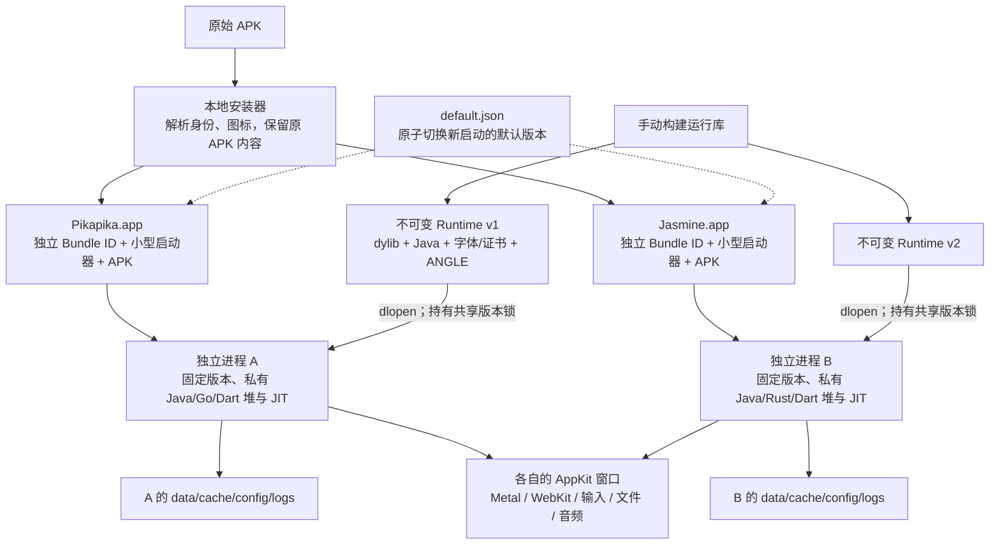
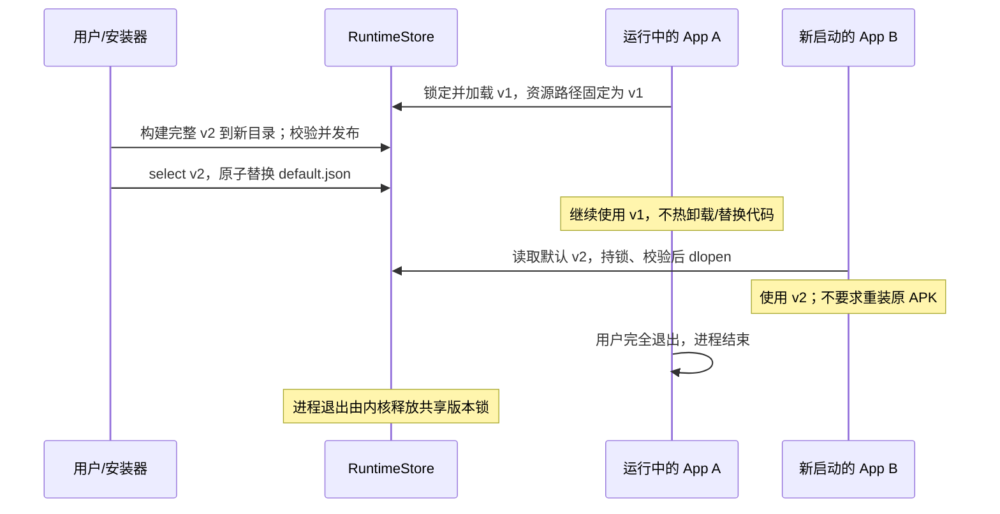

# macOS 独立 APK App：使用与实现

日期：2026-11-06。目标平台：Apple Silicon macOS。本文记录实际实现；完整隔离目标与 iOS 接入要求见[架构设计](07-independent-app-runtime-design.md)和[执行方案](08-independent-app-runtime-execution-plan.md)。

## 运行方式



共享的是磁盘上的不可变运行库。每个 `.app` 有独立进程，运行库中的可写全局状态、Java/原生堆、线程和 JIT 随所属进程分开。安装器不承载业务，不需要常驻管理进程；关闭安装器不会结束已启动的 App。

macOS 外壳包含独立 Dock/窗口身份、真实 CAMetalLayer 呈现、原生 WKWebView、鼠标点击/拖动/滚轮、键盘及中文输入提交、剪贴板、系统分享、打开 URL 和文件选择。文件选择结果复制进本 App 的 `data/imports`；Android 模拟外部存储位于本 App 的 `data/sdcard`。不会因失去焦点而结束或暂停 App。

独立应用窗口支持拖动边框调整大小。窗口点尺寸乘以原有 Android density 得到新的渲染像素尺寸，Metal drawable、原生窗口尺寸、Android DisplayMetrics/Configuration 和 ViewRoot 随之更新；SurfaceView/TextureView 通过现有的尺寸变化回调通知 Flutter 等渲染引擎。原生 WebView 跟随 Android 布局铺满其区域，不额外加入固定比例黑边。配置变化通过当前 Activity 的 `onConfigurationChanged` 和视图重排处理，不在每次拖动时重建 Activity。修改窗口宿主后，已安装应用和图形安装器内捆绑的 `HuskAppHost` 需要更新，并选择带 `resize` 接口的新版 Runtime；已打开的旧进程需完全退出后重新打开。

## 本地构建与安装

已提供图形安装器，支持双击 APK、查看全部已登记应用、搜索、启动和卸载。当前安装位置为 `~/Applications/Husk APK Installer.app`；图形安装默认生成 `~/Applications/Husk Apps/<应用名>.app`。使用、构建和实测见[APK 安装器与管理](14-macos-apk-installer.md)。以下保留命令行与 Runtime 构建方式。

先准备仓库已有的 `build/java-runtime`、`build/android-system` 与 Java 构建所需 JDK/R8。只重建 Java 框架可用：

```sh
export HUSK_TASK_TMPDIR="$(python3 -B tools/task_paths.py macos-apps)"
export TMPDIR="$HUSK_TASK_TMPDIR/tmp" TMP="$HUSK_TASK_TMPDIR/tmp" TEMP="$HUSK_TASK_TMPDIR/tmp"
export PYTHONDONTWRITEBYTECODE=1 PYTHONPYCACHEPREFIX="$HUSK_TASK_TMPDIR/tmp/pycache"

HUSK_JDK=/opt/homebrew/opt/openjdk@21/libexec/openjdk.jdk/Contents/Home \
HUSK_D8="$PWD/build/tools/r8.jar" \
src/java-framework/build.sh build/java-runtime/husk-framework.dex

python3 tools/runtime/fetch_macos_fonts.py
sh scripts/build_macos_runtime.sh --profile macos-app --build-id my-mac-runtime-001
python3 tools/macos/install_apk.py select build/macos-runtime/my-mac-runtime-001
python3 tools/macos/install_apk.py settings --store build/macos-runtime --jit-mib 512
python3 tools/macos/install_apk.py install /absolute/path/application.apk
python3 tools/macos/install_apk.py list
```

命令行安装器默认输出 `build/macos-apps/<应用名>.app`，可在 Finder 双击或用 `open` 启动。`--applications` 可以指定其他应用目录；不是必须放在系统 `/Applications`。运行库目录必须保持原路径可访问。

app profile 会复制匹配的 macOS arm64 ANGLE 库及其许可证，运行时不依赖 VS Code 安装。开发构建默认从本机 VS Code 的 Electron 提取；其他来源必须同时显式提供 `--angle-dir` 和与该构建匹配的 `--angle-license`。不修改源应用。manifest 记录来源摘要，并逐文件校验发布包；不接受 iOS/Simulator 的图形库。

中文字体沿用 Husk 的 Noto CJK 来源。完整运行库应在 `resources/android-system/fonts` 带 `NotoSansCJK-Regular.ttc` 及其 OFL 许可证；Java dex、字体、图形和证书都属于同一版本清单。

安装器从同一份 APK 暂存快照解析并发布，原 Downloads 文件不变。Bundle ID 从真实包名稳定派生，APK 文件名使用 SHA256。安装采用指定任务临时目录暂存、同卷校验、签名校验、目录互斥和排他原子发布。临时目录与交付目录不同卷时明确拒绝，不改用交付目录做临时区。当前拒绝覆盖已有同包安装；尚未实现 Android 签名连续性验证，因此 APK 自身更新不会借用运行库升级流程覆盖旧应用。

默认数据目录：

```text
~/Library/Application Support/Husk/Apps/<Bundle ID>/
  data/             # 持久数据，包括 Android files、数据库和 sdcard
  cache/            # 可丢弃缓存；正常启动不逐帧写截图
  config/
  logs/<generation>.log
  instance.lock     # 同一 App 的同一数据目录只允许一个执行进程
  status.json       # PID、执行代次、固定运行库、帧数和 footprint
```

JIT 是整个 Runtime store 的统一手动设置，2–1024 MiB，默认 512 MiB。每次新启动按该值实际申请并核对容量；不会自动估算、学习、扩容或缩小。Java 启动 worker 保持 32 MiB 原生栈。

### 两个测试 APK 的首次启动

这两个 APK 保留了各自原有的首次入口，后续仍在 App 自己的界面操作：

- Pikapika v1.8.23 首次进入计算器，输入 `77554422` 后按 `=`，再按应用提示关闭并重新打开，进入账户页。
- Jasmine v1.7.22 首次进入浏览器，在地址栏输入 `jm://start` 并提交，进入登录页。

验收通过真实窗口点击和文本提交走这些流程，持久标志由 APK 自己写入；没有编辑数据库跳过初始化。测试未创建账号，也没有向服务端提交测试用户名和密码。账户验证、漫画内容读取和付费/授权业务需要对应账户与服务另外验收。

## 运行库升级



发布版本使用新的 build ID，永不覆盖原目录。`select` 验证完整清单、平台、图形依赖及签名后切换默认值。运行中的进程不反复读取默认索引，不 `dlclose`，后台恢复也保持旧版本；彻底退出后再打开才使用新版本。

本实现不自动 GC。`.leases/<build-id>.lock` 是稳定的锁对象，不能替换或删除；任何后续回收器必须先取得该锁的排他持有并排除活动默认版，再回收内容。不能用 `rm -rf` 删除活动版本。现有测试会覆盖多读者、强杀、锁替换和清单破坏。

## 代码边界与移植接口

| 模块 | 当前代码与职责 |
|---|---|
| Bootstrap ABI | `src/runtime-api/husk-runtime-v1.h`；版本/能力、显式路径与设置快照，不执行 APK |
| App ABI | `src/runtime-api/husk-runtime-app-v1.h`；独立 getter、start/stop/state、输入/文本/文件结果与 WebView attach |
| Runtime bridge | `src/runtime/husk-runtime-app-v1.m`；内部 Java/JNI/ELF/图形初始化、显式资源定位与回调转换 |
| Mac 窗口宿主 | `tools/macos/HuskAppHost.m`；只含公共头文件，用 dlopen/dlsym 取得两张 ABI 表，无静态 core 依赖 |
| 发布器 | `tools/runtime/package_macos.py`；完整内容摘要、只读目录、稳定租约与排他发布 |
| 安装/选择器 | `tools/macos/install_apk.py`；APK 身份/图标、独立 `.app`、默认版本与手动 JIT 设置 |
| 验收驱动 | `tools/macos/acceptance.py`；真实 AppKit 进程、各自控制/数据/日志、截图与 A 崩溃后 B 连续运行 |

冻结的 app-v1 表前缀允许将来在尾部增加可选接口；新增运行库不能改变既有字段顺序或扩大这个最低前缀要求。新外壳需要更大表时仍检查实际 `struct_size`，不兼容版本会在 Guest 执行前显示错误。首次开发期的候选包不作为已发布的 ABI 兼容承诺。

窗口尺寸更新使用 ABI-1 表尾的 `resize(width, height, error, capacity)`，冻结前缀保持不变，旧宿主仍可加载新版 Runtime。新版可调整窗口的宿主需要此接口；在主线程通知 Runtime 后，配置回调和布局更新排到 Java 主线程。渲染线程读取原子尺寸快照，旧的 Java 屏幕位图在替换时显式回收。

ABI 使用 `struct_size` 和独立版本号协商，字符串在 start/configure 时复制，宿主视图、layer、回调 userdata 保留到进程退出。剪贴板用调用方缓冲区，避免跨库内存释放约定。start/stop 在 worker 调用，主线程持续运行；一个进程只允许一次 APK 启动尝试。错误或完全关闭都结束该 App 的进程，不复用半初始化状态。

APK 明确调用 `exit(status)` 时，独立应用 profile 直接按该状态结束本进程，不先取消其他工作线程。这样保留 APK 的退出语义，避免本已请求 `exit(0)` 的 Flutter 窗口因宿主先取消 Go 数据库 I/O，又被后台 panic 改成 `exit(2)`。普通 Activity.finish 和窗口关闭仍可走宿主的清理路径。

普通窗口关闭时，本 profile 在停止阶段也不向原生文件 I/O 注入 `ECANCELED`，避免 Go/SQLite 把人为取消当成数据库故障并 panic。Java 入口和事件循环仍进入停止阶段；三秒内未收拢的原生工作保留到进程退出，由内核回收。宿主不复用进程、不卸载存活映像，也不能在进程结束前假定这些资源已归还。纯 Java/WebKit fixture 的两次内部收拢与大型 APK 的进程结束分别验收，具体结果见[验收记录](13-macos-release-validation.md)。

所有本地验证的日志、截图、APK 快照、harness、编译中间文件与暂存发布目录都在 `/Users/m1p0/Developer/temp/codex/Husk/<任务名>-<随机标识>/`，由 `tools/task_paths.py` 统一管理并向子进程传递临时/缓存目录。正式源码、回归工具、安装后的 `.app` 和发布后的完整 Runtime 保留在项目约定位置。运行时的临时文件、匿名共享内存和 Unix socket 映射尊重显式临时目录；非法目录失败，不再回退到 `/tmp`。

未来 iOS 复用 APK/DEX/ELF、Bionic/JNI、Java 框架、启动 ABI、完整版本清单、持有协议和验收场景；替换 AppKit 窗口/输入、系统注册/容器、签名/JIT、权限/后台及资源限制适配。macOS `.dylib` 和 ANGLE 必须重新编译成正确的 iOS 目标，不能直接拷贝。当前 Mac adapter 有明确平台编译约束；移植工作集中在宿主适配和实机能力验证。

## 验收与保证范围

本实现是 `macos-functional`，尚未声明 `macos-sandboxed`。独立进程和目录不等于系统禁止同用户程序访问另一目录或发信号。内存 footprint 可观测，系统硬限制能力仍为 `unsupported`；共享物理内存和 GPU 意味着不能承诺任意整机压力下 B 永不受影响。没有用整机 OOM 测试代替隔离证明。

本机安全探针 `tools/macos/probe_memory_limit.c` 只对自己的轻量进程请求 64 MiB footprint limit，实际返回 `KERN_NO_ACCESS`（8），没有进行压力分配或修改其他进程。[Apple XNU 对应入口](https://github.com/apple-oss-distributions/xnu/blob/main/osfmk/kern/task.c)检查 `proc_check_footprint_priv`；该结果只证明当前宿主身份下不能通过这一接口建立限额，不能泛化为所有 macOS 或未来 iOS 都没有限额能力。

**长期内存验收尚未通过。** 现有 DVM 的 GC 和 Java 终结调度没有实现。新桥接已对原始帧队列、SurfaceTexture producer、NativeWindow/EGL 引用进行显式回收，但应用从 `Bitmap.wrapHardwareBuffer` 取得的独立 Bitmap 会依赖尚缺失的可达性回收。不能提前回收仍可能被应用持有的 Bitmap；也不能因为 ImageReader 队列有限就宣称全部像素内存有界。具体根集合、并发与终结依赖、分阶段实施见[DVM 内存回收方案](12-dvm-memory-reclamation-plan.md)。

当前发布、回归结果和真实窗口验收进度见[发布与验收记录](13-macos-release-validation.md)。已知需要账户或第三方服务的路径，必须分别记录实际成功、外部错误与未测，不用首帧代替业务验收。

公共接口与版本持有回归：

```sh
sh tests/runtime/run_macos.sh
python3 -B tests/macos/test_window_resize.py
python3 tests/translation-layer/run_guest_tls.py
python3 tests/translation-layer/run_native_window_lifetime.py
python3 tests/java-framework/run.py
```

上述窗口回归检查五种尺寸下的真实 AppKit 视图、drawable、输入和原生覆盖层。另可加 `--app /absolute/path/Husk\ Java\ Fixture.app --runtime /absolute/path/runtime --out /absolute/task/evidence`，启动源码 fixture，核对实际 EGL 帧像素尺寸、Android 配置、原生 WebView 宽度和按钮点击，并保留真实窗口截图。

托管 CI/CD 保持关闭；这些都是本地手动命令。
