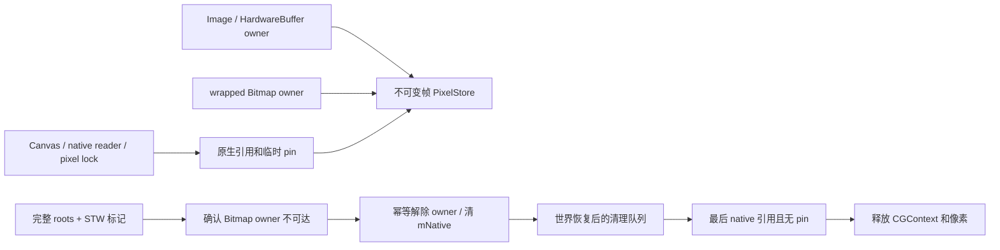

# DVM 对象与 native 图像内存回收：审计及执行方案

日期：2026-11-06。**本文是源码审计和待执行方案，不是已实现的 GC，也不是长期内存稳定验收。** 尚未按本文方案实现 VM/JNI 可达性回收、终结调度或 PixelStore。独立 App 的运行、显式图像释放与进程隔离状态见 [macOS 实现记录](11-macos-independent-apps.md)。

当前可确认：进程退出会让 OS 回收该进程资源；框架内部一部分独占像素已有显式 `recycle/close/release` 路径；DVM 运行期间没有可达性 GC。不能把短时间 GUI 成功、两个进程地址空间独立或退出后释放，描述成长时间运行时的内存稳定。

## 1. 源码现状与直接影响

| 现状 | 源码位置 | 含义 |
| --- | --- | --- |
| `obj_alloc` 直接 `calloc`，无 managed heap 对象登记表 | [jni.c:38](../src/translation-layer-next/husk-tl-jni.c#L38) | 目前既不能枚举所有对象，也不能判断任意字是否为合法对象地址 |
| DVM 启动后 `tl_jni_unref` 直接返回 | [jni.c:50](../src/translation-layer-next/husk-tl-jni.c#L50) | 修复 native 引用配对是必要的，但不会独自回收运行中的 Java 对象 |
| DVM 新对象、字符串和 native 返回值经常置 `refs=1<<30` | [dvm.c:325](../src/translation-layer-next/husk-tl-dvm.c#L325)、[738](../src/translation-layer-next/husk-tl-dvm.c#L738)、[1421](../src/translation-layer-next/husk-tl-dvm.c#L1421) | 现有 `refs` 不是 Java 可达性；不能把其非零作为 GC root |
| `Runtime.nativeGc` 是空操作 | [dvm-natives.c:903](../src/translation-layer-next/husk-tl-dvm-natives.c#L903) | 调用 `System.gc()` 不会改变上述情况 |
| Bitmap 有 `finalize()`，但没有 GC 发现与终结调度 | [Bitmap.java:119](../src/java-framework/src/android/graphics/Bitmap.java#L119) | 写了 finalizer 不等于 finalizer 会运行 |
| 每个 `gbitmap` 分别分配 RGBA 像素和 CGContext | [graphics.c:49](../src/translation-layer-next/husk-tl-dvm-graphics.c#L49)、[63](../src/translation-layer-next/husk-tl-dvm-graphics.c#L63)、[105](../src/translation-layer-next/husk-tl-dvm-graphics.c#L105) | 丢失 Java Bitmap 引用后，大块 native 像素仍可能一直存活 |
| slot 扩容刻意保留旧数组 | [dvm.c:701](../src/translation-layer-next/husk-tl-dvm.c#L701) | 这是并发读者的保活措施，不能在没有停顿/epoch 机制时顺手 free |

### ImageReader / HardwareBuffer / Bitmap 路径

当前路径：`SurfaceTexture.huskPost` 复制不可变帧 → `ImageReader` 的 pending/acquired 帧 → `HardwareBuffer.Pixels` → `Bitmap.wrapHardwareBuffer` 再复制一份像素。

- 源帧快照：[SurfaceTexture.java 的 `huskPost`](../src/java-framework/src/android/graphics/SurfaceTexture.java)。
- pending 丢帧和 `Image.close()`：[ImageReader.java:57](../src/java-framework/src/android/media/ImageReader.java#L57)、[176](../src/java-framework/src/android/media/ImageReader.java#L176)。
- `Pixels.refs`、独立 HardwareBuffer 引用及复制：[HardwareBuffer.java:55](../src/java-framework/src/android/hardware/HardwareBuffer.java#L55)、[87](../src/java-framework/src/android/hardware/HardwareBuffer.java#L87)、[91](../src/java-framework/src/android/hardware/HardwareBuffer.java#L91)。
- 独立 wrapped Bitmap：[Bitmap.java:213](../src/java-framework/src/android/graphics/Bitmap.java#L213)。

`Image.close()` 只释放该 Image 对源帧的所有权；已经交给调用者的 wrapped Bitmap 是另一份独立像素，不归 Image 所有。当前每次 wrap 至少新增 `width × height × 4` 字节：720×1280 为 3.52 MiB，1080×1920 为 7.91 MiB。如果实际每秒 wrap 60 次，对应理论新增约 211/475 MiB/s；这是容量计算，**不是当前 APK 的实测调用率**，需要按分配入口计数。

pending/acquired 队列有上限，不能限制调用者丢弃但 VM 没有回收的 wrapped Bitmap。`ImageReader.getPlanes()` 还会 `allocateDirect` 一份像素：[ImageReader.java:168](../src/java-framework/src/android/media/ImageReader.java#L168)；`mPlane=null` 并不自动释放没有 GC/Cleaner 调度的 native direct memory，需要单独核算。

Android 官方规定 wrapped Bitmap 自持 buffer 引用，关闭 HardwareBuffer 不应使 Bitmap 失效，且 Bitmap 使用期间不得修改共享 buffer；`Image.getHardwareBuffer()` 返回的原 handle 则不应在 Image 关闭后继续使用。应把**handle 有效期**和**Bitmap 自有像素引用**分开实现。[Bitmap API](https://developer.android.com/reference/android/graphics/Bitmap#wrapHardwareBuffer(android.hardware.HardwareBuffer,%20android.graphics.ColorSpace))、[Image API](https://developer.android.com/reference/android/media/Image#getHardwareBuffer())。

因此禁止以下“止血”：在 `Image.close()`、下帧到来、view 隐藏或超过固定帧数时回收旧 wrapped Bitmap。调用者可能把它留在字段、集合、JNI global ref 或另一个线程，稍后再次绘制。

## 2. 最小 GC 必须覆盖的 roots 与边

下面是 root 类别清单；不是声称各模块已完成 GC root 注册。启用 sweep 前必须逐模块登记并验证，没有被审计的 native 对象不能默认“不含 Java 引用”。

| 类别 | 必须保活或扫描的内容 | 当前落点 / 缺口 |
| --- | --- | --- |
| 所有活动解释器调用 | 每一层 `regs`、`self`、参数、返回值、`result`、`caught`；包括大于 64 个寄存器的 heap 数组 | [dvm.c:1230](../src/translation-layer-next/husk-tl-dvm.c#L1230)、[1818](../src/translation-layer-next/husk-tl-dvm.c#L1818)；现有 `t_frames/t_pcs` 只记录 method/PC，不记录 roots |
| intrinsic / HLE / JNI 调用中的临时对象 | C 局部变量、调用参数、返回值过渡、CPU 寄存器、已借出的 payload 指针 | [dvm.c:1233](../src/translation-layer-next/husk-tl-dvm.c#L1233)、[1367](../src/translation-layer-next/husk-tl-dvm.c#L1367)；不能只登记 interpreted frame |
| 所有 Java / native callback 线程 | `t_thread`、`t_pending`、尚未启动的 `start_arg.thread`、native 重新进入 Java 的入口 | [dvm-natives.c:598](../src/translation-layer-next/husk-tl-dvm-natives.c#L598)、[749](../src/translation-layer-next/husk-tl-dvm-natives.c#L749)、[jni.c:470](../src/translation-layer-next/husk-tl-jni.c#L470)；debug `t_seen` 应清空或弱化，不能成为隐含永久 root |
| JNI local/global/weak handles | 每线程 local frame、返回 local、global ref 计数、weak handle 状态 | [jni.c:701](../src/translation-layer-next/husk-tl-jni.c#L701)；Push/PopLocalFrame 当前无操作，global/local 只是 raw pointer + ref，weak slots 还复用 strong 实现 |
| class metadata 与 statics | 所有 class mirror、父类/接口、静态引用、detached `tl_jfield.dval`、proxy method/throws | [jni-internal.h:26](../src/translation-layer-next/husk-tl-jni-internal.h#L26)、[37](../src/translation-layer-next/husk-tl-jni-internal.h#L37)、[dvm-internal.h:65](../src/translation-layer-next/husk-tl-dvm-internal.h#L65)；首版可保持 class 不卸载 |
| DEX / VM 全局缓存 | `scache`、每个 dex 的 loader、`g_app_loader`、intern table、VMRuntime 单例、预分配 OOM | [dvm-internal.h:24](../src/translation-layer-next/husk-tl-dvm-internal.h#L24)、[dvm.c:2341](../src/translation-layer-next/husk-tl-dvm.c#L2341)、[dvm-natives.c:159](../src/translation-layer-next/husk-tl-dvm-natives.c#L159) |
| native UI/engine 持有者 | `A.content/gl_view/gl_renderer`、HLE `H` 单例、FMOD self、NDK window.texture、输入对象池、异步 job/listener | [dvm-android.c:38](../src/translation-layer-next/husk-tl-dvm-android.c#L38)、[jni-hle.c:31](../src/translation-layer-next/husk-tl-jni-hle.c#L31)、[1050](../src/translation-layer-next/husk-tl-jni-hle.c#L1050)、[jni-input.c:128](../src/translation-layer-next/husk-tl-jni-input.c#L128)、`bionic-ndk.c` 的 native window |
| opaque native 容器的出边 | `jobj.native` 指向的容器及其二级数组中的 Java 指针；不是一律当作普通字节 | [jni-http.c:32](../src/translation-layer-next/husk-tl-jni-http.c#L32) 的 hmap.k/v、[71](../src/translation-layer-next/husk-tl-jni-http.c#L71) 的 headers、[223](../src/translation-layer-next/husk-tl-jni-http.c#L223) 的 alist.items；其他 native 容器需要 tracer |
| monitor / wait / thread handoff | 持锁、等待锁、`Object.wait`、class-init 等待中的 Java 对象及传递尚未完成的对象 | [dvm.c:849](../src/translation-layer-next/husk-tl-dvm.c#L849)；`mon` 当前只有 pthread/链表信息，没有反向 owner-object handle，必须补可扫描关系 |
| 外部内存和编码 handle | array/critical/direct-buffer pins、Unsafe raw memory 中的引用、ARM32 handle 表、guest ELF/global callback 持有者 | [jni.c:1095](../src/translation-layer-next/husk-tl-jni.c#L1095)、[1170](../src/translation-layer-next/husk-tl-jni.c#L1170)、[dvm-natives.c:1623](../src/translation-layer-next/husk-tl-dvm-natives.c#L1623)、[arm32.c:67](../src/translation-layer-next/husk-tl-arm32.c#L67) |
| Reference / finalizer 生命周期 | weak/soft/phantom referent、待终结对象及可被终结器复活的引用闭包、终结队列 | [dvm-natives.c:1795](../src/translation-layer-next/husk-tl-dvm-natives.c#L1795) 当前只有字段 get/clear，无弱引用处理和终结队列 |

标记的传递闭包必须扫描 `jobj.fields`、对象数组、class mirror 的 Java 字段，以及已登记的 native tracer。不能盲解引用“看起来像地址”的数值：首先用 heap registry 确认它属于已登记对象/有效 payload；不能把 native `mNative` 的整数值误当 `jobj *`。

首版可保守扫描全部寄存器和 `jvalue`，允许误保活，不允许误回收。不能直接把所有 primitive payload 都视为无指针：当前 Unsafe 实现允许向 primitive array 或 raw memory 写对象位模式，必须登记出边、保守扫描这些区间，或明确关闭这类 GC 支持；遗漏它们不能算安全降级。

`jobj.native` 的 native pointer 不一定指向 Java 容器，例如反射对象指向 method/field metadata，文件对象存 fd；需要按类型注册 tracer/destructor，不能对未知大小的地址直接递归扫描。

## 3. 停顿和线程安全条件

现有 [session.c:94](../src/translation-layer-next/husk-tl-session.c#L94) 记录 calls/workers 和停止唤醒；它是**退出协议**，不是 GC safepoint 协议。不能用 `tl_session_request_stop()` 做周期性 GC：该操作取消执行，不会暂停后恢复同一个 Java 世界。

建议先实现非移动、单代、stop-the-world 标记，避免在现有 raw JNI pointers、Unsafe 和 native 像素地址上引入对象搬迁。分配阈值只请求 GC；真正 sweep 必须满足下面的停顿条件。

1. 建立 mutator thread registry，登记主 Java/GL 线程、Java 创建的 pthread、JNI Attach/GetEnv 进入者、HLE callback 线程；Detach 和 pthread cleanup 均解除登记。当前 [vm_Attach/Detach](../src/translation-layer-next/husk-tl-jni.c#L1197) 尚无此功能。
2. 为每次解释器、intrinsic、HLE 和 native 调用发布 shadow-frame/root scope。解释器根数组不能仅存在 C 栈中而没有登记；大 `regs` 在 malloc heap 上，扫描 C 栈本身找不到其全部内容。
3. 在 bytecode dispatch/backedge、调用/返回边界和 JNI 状态切换检查请求，发布根和调用结果后进入 parked 状态；异常展开、`pthread_exit`、取消清理必须对称弹栈。现有 dispatch 入口在 [dvm.c:1827](../src/translation-layer-next/husk-tl-dvm.c#L1827)。
4. JNI local/global/weak 表和 native pin 表在 GC 请求前可枚举；native 返回给 Java 的新对象必须在任何可能停顿的位置之前可见。不能在持 class/monitor/native-container 锁时 park，让 GC 线程再申请同一把锁。
5. 先阻止新 mutator 进入，再等待所有 mutator 处于已发布根的安全状态，或在有完整 handle/pin 的明确 native-safe 状态。长时间 opaque native 调用、未登记线程、critical pointer 持有者无法安全确认时，本轮 GC 超时放弃，保留内存；不能把未响应线程当作已停止。
6. stop-the-world 期间不运行任意 Java finalizer，不发 UI dispatch_sync，不调用可能等待被暂停线程的 CoreGraphics/其他平台清理。先冻结并标记、登记要回收的资源；恢复线程后，通过具有明确所有权的清理队列释放 native payload。

纯合作停顿的实际风险：长期不返回的 guest native 工作可能令 GC 一直无法完成。因此“正确地放弃一次 GC”也不等于能承受持续帧分配，必须在真实 APK 上记录停顿完成率、最长延迟、放弃原因和后续内存变化。这个门槛不通过，就不能宣称长期回收已解决。

## 4. native Bitmap 的最小安全终结

**只回收 native Bitmap 像素，也需要完整的 root/transitive reachability。** 保留 Java shell 并不能使提前清掉它的 `mNative` 变得正确；weak ref、native handle 或漏扫容器仍可能稍后返回该 shell。

先给 native 图像资源定义独立的 `PixelStore` 所有权：

- 每个 Bitmap wrapper、HardwareBuffer owner、Canvas 和 native reader 持有各自引用；`recycle`、`close` 和 GC cleanup 都只能幂等释放本人的引用。
- `AndroidBitmap_lockPixels` 到 unlock、GL 上传/读图、异步 native 使用需要 pin。当前 [graphics.c:94](../src/translation-layer-next/husk-tl-dvm-graphics.c#L94) 直接借出裸像素，没有 pin 计数。
- 当前 [cv_new](../src/translation-layer-next/husk-tl-dvm-graphics.c#L395) 借用 Bitmap 的 CGContext，`cv_free` 还会恢复 graphics state；若先 `bm_free` 再 `cv_free` 会访问已释放 context。正确选择是让 Canvas 原生持有 PixelStore/context；否则清理队列必须先销毁 Canvas 再 Bitmap，并处理仍在执行的读者。不能靠“它们都不可达”忽略终结顺序。
- cleanup descriptor 不应含无意中的强 Java owner root，否则所有候选对象永久存活；需要 registry 的非 root 行政记录或收集器支持的弱关联。原生句柄应带身份/代次，防 double-free 和地址重用造成 ABA。
- native-only 首版不调用任意应用 `finalize()`，不能冒充完整 Java finalization。对尚未实现的 weak/soft/finalizer 语义采取保守保活，并准确标注支持范围；尤其不能在可能复活 Bitmap 的终结器运行之前释放其像素。
- 保持 retained Bitmap 跨 `Image.close()` 可读。保留独立复制是正确但昂贵的方案；优化为共享时，应共享**不可变的 frame PixelStore**，由 wrapped Bitmap 独立 retain，并在 producer 需要修改时使用新 backing/COW。不能复用仍被 Bitmap 持有的 frame。

共享 PixelStore 只能消除 wrap 的额外整帧复制，**不会单独消除“丢弃 Bitmap 从未释放 owner”的泄漏**；没有 GC/显式 recycle 时，每个历史帧仍可能被遗留 owner 保活。

## 5. 是否引入成熟 conservative GC

BDWGC 是可评估的候选，不是只替换 `obj_alloc` 就能上线的修复。其官方说明明确：普通 system malloc 块里的引用通常不被跟踪，TLS 单独持有也有约束；提供 root 注册、线程注册和 finalizer 接口。[接口说明](https://www.hboehm.info/gc/gcinterface.html)、[gc.h](https://github.com/bdwgc/bdwgc/blob/master/include/gc/gc.h)。

集成必须覆盖所有指针承载块：对象、fields、对象数组、DEX/class/static/intern 缓存、heap `regs`、native 容器的二级数组等；并登记 JNI roots、TLS、回调与 guest native 持有关系。把 class/statics 根之外的所有普通 malloc 块一律登记为永久 root，又会把本应死亡的对象全部保活。

BDWGC 的 [Darwin stop-world 源码](https://github.com/bdwgc/bdwgc/blob/master/darwin_stop_world.c) 含 AArch64 线程/栈处理，可以减少自写宿主栈和寄存器采集的工作；仍需验证 Husk 的 JIT 信号处理、guest alternate/Go stacks、native 回调线程及动态映射关系。不能把 Mac 构建成功外推成未来越狱 iOS 权限和停顿能力已验证。collector 内的最终清理也不能跳过上一节 PixelStore/Canvas 所有权约束。

建议先做独立原型对照，选择“自有非移动标记器 + 显式 roots/safepoints”或“BDWGC + allocator/root 集成”。两者都必须通过同一组 roots/retained Bitmap 验收，再决定合入；不在当前双 APK GUI 验收过程中顺带全局替换 malloc 或启用增量页保护。

## 6. 分阶段执行与退出条件

| 阶段 | 最小工作 | 验收门槛 |
| --- | --- | --- |
| G0 归因与计量 | 在 Bitmap/pixel/Canvas 分配和显式释放入口统计 live count、live bytes、峰值、调用种类；同时记录真实 footprint | 分开显示 Java shell、native 像素、CG/GL、帧缓存与固定 JIT；确认每秒 wrap 频次，不能只看总 RSS |
| G1 已知独占资源显式释放 | 完成 SurfaceTexture stage/front/back/canvas、ImageReader pending/acquired、NDK window/EGL ownership 的对称清理；列出所有权状态 | 被调用者明确关闭/丢弃的内部缓冲回到基线；retained Bitmap 仍可读；这一步不声明 GC |
| G2 root 与线程基础设施，只观察 | heap registry、mutator/shadow-frame、JNI local/global/weak 表、pins、native tracer、GC 停顿协议；先输出 would-reclaim 不实际 free | 全 root 矩阵持有时均被标记；未注册线程/未知 native 容器/停顿超时使收集拒绝，不得继续 sweep |
| G3 原生图像终结 | PixelStore 引用/pin、Canvas 安全顺序、幂等 Bitmap cleanup；只回收已证明不可达且不受未处理终结语义影响的 native payload | ASan 并发和保活测试全部通过；不把 Java shell 未释放隐藏为已完成整堆 GC |
| G4 一般 Java 回收 | 回收对象、fields、数组、字符串、monitor/native payload；实现 Reference/finalization/resurrection 与 native allocation accounting | 循环结构可回收，JNI/弱引用语义与异常/退出一致；NativeAllocationRegistry/DirectByteBuffer 生命周期一并覆盖 |
| G5 实际 APK 长期验收 | 固定版本和显式 JIT 设置下做持续帧生产、页面切换、隐藏/恢复、ImageReader 重建、重复退出重开 | 内存形成与真实存活对象数一致的平台；无丢图/UAF/提前回收；记录时间、帧数、峰值、GC 暂停及所有放弃；本阶段当前未通过 |

至少保留以下针对性测试，不用整机 OOM 来证明正确性：

1. Bitmap 分别只存在于 Java local、返回值过渡、异常/caught、对象字段、父类字段、数组、collection、static、class mirror/proxy metadata、DEX cache、intern 和 loader 中时均存活。
2. JNI local frame/global ref、NDK/EGL window.texture、HLE native map/list、异步 listener、线程启动参数、持锁/等待对象单独保活；去掉最后一个根后才允许回收。
3. `GetPrimitiveArrayCritical`/lockPixels/direct native reader 期间 GC 不释放 backing；并发创建、显式 recycle、close 与 GC 不 double-free。
4. `wrap A → close hardware/image/reader → 产生并处理很多 B 帧 → 重新绘制 A`，A 的像素与内容仍正确；显式释放/GC 处理 A 后，其 owner 只减一次。
5. 连续 wrap 后丢弃旧结果，完成实际可达性回收后 live pixel bytes 达到平台；对照“保留 N 份 Bitmap”应增加约 N 份真实 backing，不能强行压回固定水位。
6. Bitmap/Canvas/Shader 形成不同可达组合及清理顺序；pending finalizer/resurrection/weak-get 不返回已释放 native 资源。
7. 未登记 callback 线程、长时间 native 调用、线程退出/取消、停顿超时均不触发不完整 sweep；退出和新交互会话都重复验证。

源码改动应按 G0/G1、G2、G3、G4 分开评审；G2 的 root 声明不完整时不得启用 G3。当前授权仅形成此文档，不执行 GC 原型或大范围 VM 重写。

## 7. GC 与系统内存限制的边界

GC 解决不可达对象回收；系统限额解决超额资源的强制归属，两者不能互相替代。手工 JIT 容量仍是进程固定配置，不因这份方案引入自动扩缩容。

当前 Mac 的安全 self 探针 [probe_memory_limit.c](../tools/macos/probe_memory_limit.c) 只对自身请求 64 MiB，没有分配压力，也未操作其他进程。本次结果为 `kern_return=8 (KERN_NO_ACCESS)`、`hard_limit_verified=false`，原始 JSON 已按统一临时目录规则归档到本任务证据目录的 `legacy-build/logs/macos-memory-limit-probe.json`。Apple 的 [XNU task.c](https://github.com/apple-oss-distributions/xnu/blob/main/osfmk/kern/task.c) 在 `task_set_phys_footprint_limit` 中检查 `proc_check_footprint_priv`，失败返回该错误。

此记录只说明**本次运行身份和环境没有取得该接口所需授权**；不是所有 Mac 或未来 iOS 的不可能性证明。即使之后 setter 成功，也仍要单独验证有效限制、前后台切换、超额动作及 WebKit/GPU/helper 资源归属。当前不得承诺“A 任意增长时 B 永不受整机压力影响”。
